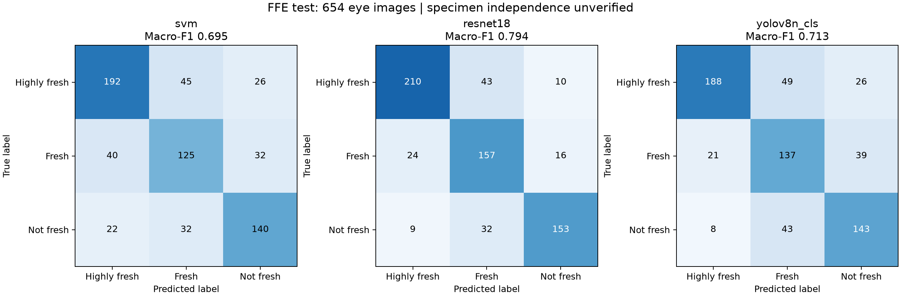
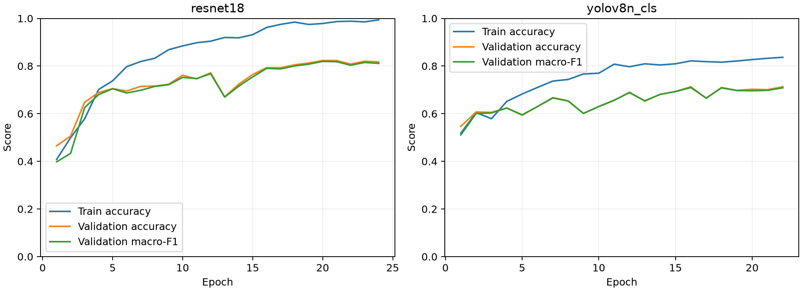

# FishLens 项目进度与研究结果总结

更新日期：2026-10-18。本文记录当前代码、已完成实验和本地联调结果，供小组交接及报告撰写使用。

## 1. 当前完成情况

项目现已完成两个相互独立的图像分类功能：AutoFish 五类鱼种识别，以及 FFE 三类鱼眼新鲜度识别。两项任务均按验证集表现选择 ResNet-18 作为网页默认模型，但使用不同的权重、标签和推理配置。鱼眼任务无需先识别鱼种。

| 工作项 | 当前状态 | 交付与证据 |
| --- | --- | --- |
| 数据准备 | 两套固定 train/validation/test 划分已用于实验；FFE 全部 4,390 张图已核验哈希和标签 | [数据核验记录](../evaluation/ffe_2026-10-18/data_audit.json)；完整清单在训练交付包中 |
| 鱼种模型 | 接收组员提供的 SVM、ResNet-18、YOLOv8n-cls，并保留其推理流程完成接入 | [鱼种接入说明](SPECIES_MODELS.md)；[指标摘录](../evaluation/species_2026-10-18/comparison.csv) |
| 鱼眼模型 | 本次完成三种方法训练、验证选择、固定测试集评估及模型封装 | [训练说明](FRESHNESS_TRAINING_ZH.md)；[详细结果](../evaluation/FFE_BASELINE_2026-10-18.md) |
| 网页与 API | 鱼种三种模型及选定的鱼眼 ResNet-18 已注册；两个任务均能返回真实预测 | [鱼眼接入说明](FRESHNESS_MODEL.md) |
| 安装与回归 | 校验权重的安装脚本、Windows 启停脚本、15 项自动化测试及实际模型回归已完成 | [联调记录摘要](../evaluation/integration_2026-10-18.json) |
| 尚待完成 | 独立现场数据验证、多次重复实验、自动眼部定位、更广的鱼种覆盖、外部 Agent 与地点数据 | 见第 7 节 |

鱼种训练结果来自组员交付包，本次工作没有重新训练鱼种模型。鱼眼训练与接入是本次新增工作。本文所称“完成接入”指本地代码和验证完成，不表示已部署公网服务或已合并到小组主分支。

## 2. 数据集与任务边界

| 数据集／项目子集 | 输入与标签 | 训练 | 验证 | 测试 | 合计 |
| --- | --- | ---: | ---: | ---: | ---: |
| AutoFish 五类子集 | 完整鱼身裁剪图；horse_mackerel、whiting、haddock、cod、hake | 6,019 | 1,300 | 1,180 | 8,499 |
| FFE 三类子集 | 已裁剪鱼眼图；highly_fresh、fresh、not_fresh | 3,074 | 662 | 654 | 4,390 |

**AutoFish：**项目采用的 8,499 张图对应 425 个已记录鱼个体，三个划分分别包含 301、65、59 个体；多张图不能视为同等数量的独立鱼。现有划分隔离已记录个体及关联采集组。五类对应的学名依次为 *Trachurus trachurus*、*Merlangius merlangus*、*Melanogrammus aeglefinus*、*Gadus morhua*、*Merluccius merluccius*。这是本项目选择的分类子集，与原始数据发布的 1,500 张场景图、454 个鱼个体、18,160 个分割掩码不是同一统计单位。[AutoFish 数据卡](https://huggingface.co/datasets/vapaau/autofish)

**FFE：**来源为 Mendeley Version 1，发布页标称 4,392 张，本项目实际核验并使用 4,390 张；现有记录不能解释全部两张数量差异，因此不将其直接认定为损坏图片。原数据含八种鱼，本项目将物种信息保留为分析元数据，统一学习三个新鲜度标签。发布者按原实验的第 1–2、3–4、5–6 天分别定义三类；这些标签不能换算为任意环境下的剩余保鲜期。[FFE 数据发布页](https://data.mendeley.com/datasets/xzyx7pbr3w/1)

| FFE 类别 | 训练 | 验证 | 测试 | 合计 |
| --- | ---: | ---: | ---: | ---: |
| highly_fresh | 1,235 | 266 | 263 | 1,764 |
| fresh | 924 | 199 | 197 | 1,320 |
| not_fresh | 915 | 197 | 194 | 1,306 |

两套数据的发布许可均为 CC BY 4.0；保留来源引用及裁剪、筛选、重映射说明。FFE 没有可靠的鱼个体 ID，现有划分只验证了已记录来源组／近重复组隔离，**不能证明同一条鱼在不同时间拍摄的图像完全不跨集合**。因此其测试分数可能高于真正新鱼个体上的表现。两套数据没有建立同一条鱼的鱼身与鱼眼配对关系，两个分类器分别使用各自输入。

## 3. 已完成的模型比较

### 3.1 鱼种识别：组员交付的结果

下面记录每个模型家族经验证集选择后的交付结果，不是本次重新运行的测试，也不是多随机种子的平均值。

| 模型 | 验证 Macro-F1 | 测试准确率 | 测试 Macro-F1 | 推理方式 |
| --- | ---: | ---: | ---: | --- |
| 人工颜色、纹理特征＋SVM | 90.20% | 94.75% | 95.04% | 单次特征提取 |
| **ResNet-18** | **98.95%** | **100.00%** | **100.00%** | 原图及三种翻转的概率平均（flip4） |
| YOLOv8n-cls | 98.88% | 100.00% | 100.00% | flip4 |

来源：[交付指标摘录](../evaluation/species_2026-10-18/comparison.csv)。ResNet-18 按验证 Macro-F1 选为默认模型。测试集包含 1,180 张图、59 个已记录鱼个体；满分仅描述该五类数据划分，不能推断对任意拍照条件、未见鱼种或澳洲常见鱼类也能达到满分。

交付协议还披露：SVM 测试指标在 CNN 训练前已经被查看；CNN 参数与停止依据验证集，但整个项目不能宣称全程未接触该测试集。独立外部验证仍然缺失。两种 CNN 各有两个保存的种子运行，其中一个 ResNet-18 运行被提前暂停；当前证据不足以证明充分的重复实验稳定性。

### 3.2 鱼眼新鲜度：本次完成的实验

SVM 使用 221 维 HSV/Lab 颜色和 LBP/GLCM 纹理特征，StandardScaler 只在训练集拟合；比较 24 组候选后选择 RBF、C=10、gamma=scale、class_weight=balanced。

CNN 使用 ImageNet 预训练、224×224 等比例补边、三分类头，seed=42177、batch=32、最多 24 轮、前 2 轮分类头预热及验证早停。优化器为 AdamW；仅训练集应用翻转及小角度旋转，未使用颜色扰动或随机裁剪。每个 CNN 只完成一个随机种子。训练采用 RTX 5080，Python 3.12、PyTorch 2.14.1+cu130；网站推理采用独立的 CPU 环境。

先依据验证 Macro-F1 选择模型，再冻结权重哈希与选择记录，最后评估 654 张测试图；未依据测试结果重新调参或更换模型。见[测试前选择记录](../evaluation/ffe_2026-10-18/selection_before_test.json)。

| 模型 | 验证 Macro-F1 | 测试准确率 | 测试 Macro-F1 | 最佳训练轮次 |
| --- | ---: | ---: | ---: | ---: |
| 人工颜色、纹理特征＋SVM | 72.80% | 69.88% | 69.45% | — |
| **ResNet-18** | **81.95%** | **79.51%** | **79.41%** | 20 |
| YOLOv8n-cls | 70.96% | 71.56% | 71.27% | 16 |

来源：[原始比较 CSV](../evaluation/ffe_2026-10-18/comparison.csv)及[逐类指标与混淆矩阵 JSON](../evaluation/ffe_2026-10-18/evaluation.json)。本次条件下，ResNet-18 的测试 Macro-F1 比 SVM 高 9.96 个百分点，比 YOLOv8n-cls 高 8.15 个百分点。单次实验不能证明该模型在所有数据和训练配置下都更优。

图 1：行表示真实类别，列表示预测类别。ResNet-18 最多的单向混淆是 highly_fresh → fresh（43 张）。其中 fresh 类的 Precision 为 67.67%，Recall 为 79.70%，F1 为 73.19%，说明中间阶段仍较难区分。对原因的判断需要独立数据和采集条件分析；仅凭混淆矩阵不能断定是某一种颜色或光照因素造成。

图 2：两种 CNN 的训练记录；训练损失、验证表现及保存轮次可在交付包中复核。鱼种 CNN 使用 flip4，而鱼眼使用单次推理；两项任务的数据、训练平台也不同，不应把两张表当作统一条件下的速度或架构排名。

## 4. 相关研究与本项目的关系

| 来源 | 可支持的结论 | 对本项目的意义与边界 |
| --- | --- | --- |
| Bengtson 等的 [AutoFish 论文](https://arxiv.org/abs/2501.03767)及[数据卡](https://huggingface.co/datasets/vapaau/autofish) | 数据支持鱼类细粒度分析，原论文包含实例分割与长度估计基准 | 本项目从完整鱼身裁剪图做五类分类；分类准确率不能与原论文分割 mAP 或长度误差直接比较，也不能据此宣称超过原论文 |
| Prasetyo 等的 [FFE 数据发布](https://data.mendeley.com/datasets/xzyx7pbr3w/1) | 提供八种鱼的眼部图像及按原实验阶段定义的新鲜度标签 | 支持跨这八种来源鱼训练三类眼部外观分类；不能证明跨任意物种、拍摄设备或储存条件有效 |
| [FFE 发布页所列配套论文](https://doi.org/10.1016/j.inpa.2022.01.002) | 题名明确研究 MobileNetV1 与扩展深度可分离卷积瓶颈的鱼眼新鲜度分类 | 作为相关方法线索；本文未核验全文实验协议或数值，故不引用其准确率，也不宣称已复现或超越该方法 |
| He 等的 [ResNet 原论文](https://arxiv.org/abs/1512.03385) | 残差学习用于改善深层网络训练 | 为选用 ResNet-18 迁移学习提供方法依据；本项目表现仍以自己的固定划分实验为准 |
| [Ultralytics YOLOv8 官方文档](https://docs.ultralytics.com/models/yolov8/) | YOLOv8 包含独立的 `-cls` 分类变体 | 本项目比较的是 YOLOv8n-cls 分类模型；没有训练鱼眼检测框，不能自动从完整鱼照片定位眼睛 |
| AIMS 等的 [OzFish 仓库](https://github.com/open-AIMS/ozfish) | 仓库列出约 8 万鱼类裁剪图，覆盖 70 科、200 属、507 种，来自水下 BRUVS 影像 | 是扩展澳洲鱼种的候选；尚未下载筛选、训练或接入。水下图与当前鱼身输入存在场景差异，507 种也不等于已证明覆盖澳洲大部分常见鱼 |

OzFish 若进入下一阶段，应先核对每类有效标注数、未知鱼标签、物种名映射、视频／采集来源分组及其 CC BY 3.0 AU 许可，再选择可评估的子集。现有五类模型不能通过添加名称列表直接扩展到这些类别。

## 5. 工程接入与测试结果

鱼眼权重安装时校验 SHA-256、固定选择记录及标签；启动时再次检查并只加载一次。网页上传已经裁剪的鱼眼 JPG/PNG 后，按 224 像素等比例补边与 ImageNet 归一化执行 ResNet-18 推理，输出三类之一、未经校准的 softmax 分数与模型版本。缺少已配置权重时返回 HTTP 503，不以演示数据替代真实预测。

本地 Windows / Python 3.12 / CPU 验证结果如下：

- 当前 15 项自动化测试通过，覆盖 API、缺失模型、损坏模型、训练数据契约及安装重复运行等情形。
- 对 30 张均衡抽取的验证图片，鱼眼网页 API 与直接 CPU 推理完全一致，类别全部匹配训练交付记录；相对 GPU 记录的最大分数差约为 0.00126。
- JPEG 上传正常，损坏图片返回 HTTP 400；浏览器实际上传得到 `fresh`、分数 0.734，并显示 **Model output**。
- 新增鱼眼功能后，鱼种三种模型各 5 张样本的回归共 15 次均匹配交付类别。

这些属于安装及推理一致性检查，不能作为新的准确率实验。模型尚不能判断输入是否真的是鱼眼，也没有开放集拒识、概率校准或食品安全判断能力。

## 6. 获取模型与复现

组员按[中文快速运行指南](QUICKSTART_ZH.md)安装项目和两个模型包，无需重新训练或安装 GPU 环境即可使用网站。

- [FFE 模型与实验记录 Release](https://github.com/YuLi618/42177-Group-Fish-Identification/releases/tag/ffe-freshness-v1)：包含三种鱼眼权重、固定清单、训练配置、环境记录、结果及图表；安装脚本只提取选定的 ResNet-18。
- [鱼种模型包](https://drive.google.com/file/d/1ILFvrXrha-Rv-SMK_8XcLaDa_I5N5_W9/view)：沿用组员的原有共享权限。
- [FFE 训练与复现命令](FRESHNESS_TRAINING_ZH.md)：完整复现仍需原始图片数据包。训练 Release 保留训练时快照，当前网站接入状态以本仓库文档为准。

FFE ZIP 的 SHA-256：`276af1bfa6605c03e5fa7ea9c28838987e04afb9aa66c31e1b1f6e841d95b056`。
所选 ResNet-18 权重 SHA-256：`47436cb20198b32d711d7f1e8d677c4eb901e44fa55eb053a9389ed338296778`。
模型版本：`resnet18-ffe3-seed42177-epoch20`。训练／验证／测试清单哈希见[冻结记录](../evaluation/ffe_2026-10-18/selection_before_test.json)。

## 7. 下一步小组工作

1. **组员复核与本地复现：**合并审核通过的代码，下载模型，在另一台电脑完成两个任务的安装和预测，记录环境及失败案例。
2. **优先补充独立验证：**使用未参与现有训练、验证及测试的鱼眼照片，记录鱼个体、时间、光照、设备和可靠标签。普通自摄照片可验证界面，但缺少可靠真值时不能计算新鲜度准确率。
3. **预先制定后续实验方案：**若比较多种子稳定性，先固定种子、预算、选择规则和评估方案，再训练。现有测试集已被查看，不应据其反复调参后仍称最终独立测试。
4. **完善输入范围：**研究鱼眼检测／裁剪、模糊输入提示和不支持输入的拒识。当前要求人工提供眼部近照。
5. **单独评估澳洲鱼种扩展：**从 OzFish 审核可用子集及采集分组，另设任务和外部验证，避免直接承诺“识别澳洲大部分常见鱼”。
6. **整理最终报告：**区分组员鱼种训练、本次鱼眼训练与网站接入；引用数据来源，报告各类指标、划分限制及失败案例，保留实验记录。

## 参考资料

1. Bengtson, S. H., Lehotský, D., Ismiroglou, V., Madsen, N., Moeslund, T. B., & Pedersen, M. (2025). *AutoFish: Dataset and benchmark for fine-grained analysis of fish*. [arXiv](https://arxiv.org/abs/2501.03767). [Dataset](https://huggingface.co/datasets/vapaau/autofish).
2. Prasetyo, E., Adityo, R. D., Suciati, N., & Fatichah, C. (2022). *The Freshness of the Fish Eyes Dataset* (Version 1) [Data set]. Mendeley Data. [https://doi.org/10.17632/xzyx7pbr3w.1](https://doi.org/10.17632/xzyx7pbr3w.1).
3. Prasetyo, E., Purbaningtyas, R., Adityo, R. D., Suciati, N., & Fatichah, C. (2022). *Combining MobileNetV1 and depthwise separable convolution bottleneck with expansion for classifying the freshness of fish eyes*. Information Processing in Agriculture. [https://doi.org/10.1016/j.inpa.2022.01.002](https://doi.org/10.1016/j.inpa.2022.01.002). 书目信息来自数据发布页；未核验全文实验数值。
4. He, K., Zhang, X., Ren, S., & Sun, J. (2015). *Deep residual learning for image recognition*. [arXiv](https://arxiv.org/abs/1512.03385).
5. Ultralytics. (n.d.). *Explore Ultralytics YOLOv8*. [Official documentation](https://docs.ultralytics.com/models/yolov8/). Accessed 2026-10-18.
6. Australian Institute of Marine Science, University of Western Australia, & Curtin University. (2019). *OzFish* [Data set]. [Repository](https://github.com/open-AIMS/ozfish); [https://doi.org/10.25845/5e28f062c5097](https://doi.org/10.25845/5e28f062c5097).
